<!-- ============================================================= -->
<!--  Pooja Kiran · Security Engineer                              -->
<!--  GitHub Profile README  (repo: poojakira/poojakira)          -->
<!-- ============================================================= -->

> **READ THIS LICENSE BEFORE COPYING, USING, OR MODIFYING ANY MATERIAL.** This repository's owner-controlled original content is proprietary and **All Rights Reserved**. See [LICENSE](LICENSE).

  

# Pooja Kiran

### 🛡️ Security Engineer · Agentic AI · MCP/Tool Security · Model Supply-Chain · IAM

  
  
  
  

  
  
  
  

---

## 👋 The one line that explains my work

> **An agent that can call tools, assume IAM roles, and load model weights isn't answering questions anymore — it's making privileged decisions on your infrastructure.**
> That shift is what I secure.

I build security tooling that guards the boundaries where AI **agents, tools, identities, data, and model artifacts** meet. Working, tested, reproducible tools with honest limitations.

> ⚠️ *Research & portfolio projects: functional, tested, bounded verification — not production-deployed or enterprise-hardened. Evidence is cited; limitations are documented.*

---

## 🧭 Three principles that drive everything I build

| 🧩 Capability is **not** permission | 🔏 Permission is **not** provenance | 🪪 Identity is **not** authorization |
|:---:|:---:|:---:|
| An agent *can* call a tool — *should* it? | We approved the model — can we *prove* it's the trusted one? | A valid identity can still hide an attack path. |
| → MCP Gateway | → Provenance Scanner | → Identity Guard |

---

## 🔬 Flagship Projects — Detection & Enforcement

<table>
<tr>
<td width="33%" valign="top">

### 🛡️ MCP Agent Security Gateway
`Python` · `FastAPI` · `MCP/JSON-RPC 2.0`

Inline gateway between an MCP client and downstream server. Inspects `tools/call` requests over JSON-RPC *before* execution — allow/block decisions with audit evidence.

**Controls:** capability authorization · prompt-injection inspection (69 patterns) · PII/exfiltration checks · anti-SSRF · rate limiting · tamper-evident audit logging

**Oct 2026 CI evidence:** 782 passing tests · 81.93% statement coverage (Python 3.12)

> *Capability is not permission.*

[→ Repo](https://github.com/poojakira/mcp-agent-security-gateway)

</td>
<td width="33%" valign="top">

### 🔍 HF Model Provenance Scanner
`Python` · `SafeTensors` · `GGUF` · `ONNX`

Non-executing supply-chain scanner for Hugging Face repos and local model artifacts. Inspects pickle-opcode, AST/taint, provenance, dependency, and obfuscation risk without running untrusted code.

**Oct 2026 CI evidence:** 260 passing tests · 75.67% statement coverage · 33/33 committed adversarial fixtures detected

> *Permission is not provenance.*

[→ Repo](https://github.com/poojakira/hf-model-provenance-scanner)

</td>
<td width="33%" valign="top">

### 🔐 AWS Agent Identity Guard
`Python` · `AWS IAM` · `SARIF 2.1.0`

Static IAM linter for AI-agent roles. **25 deterministic rules** for privilege escalation, `iam:PassRole`, weak trust policies, and missing permission boundaries.

**Outputs:** text · JSON · SARIF 2.1.0 · GitHub Code Scanning

**Oct 2026 CI evidence:** 244 passing tests · 3 skipped (live-scan, require credentials)

> *Identity is not authorization.*

[→ Repo](https://github.com/poojakira/aws-agent-identity-guard)

</td>
</tr>
</table>

---

## 🧪 Research & Red-Team Labs

| Repository | What it does | Status |
|---|---|:---:|
| [adversarial-ml-lab](https://github.com/poojakira/adversarial-ml-lab) | FGSM / PGD / C&W attacks + robustness benchmarks (CIFAR-10 → MITRE ATLAS AML.T0043) | `Research` |
| [llm-redteam-framework](https://github.com/poojakira/llm-redteam-framework) | Automated jailbreak simulation & guardrail evaluation | `Beta` |
| [dataset-poisoning-detector](https://github.com/poojakira/dataset-poisoning-detector) | Statistical anomaly detection for training-data integrity | `Beta` |

## 🧱 Platforms & Integration

| Repository | What it does | Status |
|---|---|:---:|
| [unified-ml-security-platform](https://github.com/poojakira/unified-ml-security-platform) | Integration workspace wiring the tools together (CI, compose validation, scans, health checks) | `Beta` |
| [mlsec-dashboards](https://github.com/poojakira/mlsec-dashboards) | FastAPI server aggregating committed JSON evidence files into browsable dashboards | `Research` |
| [mlsec-benchmark-suite](https://github.com/poojakira/mlsec-benchmark-suite) | Cross-project benchmark harness | `Research` |

## ⚙️ Applied ML & Supporting Work

| Repository | What it does | Status |
|---|---|:---:|
| [attack-v19-core](https://github.com/poojakira/attack-v19-core) | Typed Python data models + O(1) lookup for MITRE ATT&CK v19 with SHA-256 verified STIX bundles | `Beta` |
| [OS-Resource-Management-Simulator](https://github.com/poojakira/OS-Resource-Management-Simulator-Dockerized-Flask-Application) | Flask/Jinja2 OS resource-allocation simulator with Docker, tests, CI, and security checks | `Beta` |

---

## 🗺️ Frameworks I model threats against

  
  
  
  

---

## Dated CI evidence and claim boundaries (October 2026)

These numbers refer to the **linked historical CI runs**, not a live counter or deployment-level effectiveness test. The source inventory and fixture counts below are separate regression evidence.

- **MCP Agent Security Gateway:** [Python 3.12 CI run 38012954359](https://github.com/poojakira/mcp-agent-security-gateway/actions/runs/38012954359): **782 passing tests**, **81.93% coverage**. The separately counted source inventory contains **69 named runtime detector signatures**; this does not establish detector recall or production efficacy.
- **AWS Agent Identity Guard:** [CI run 38009457205](https://github.com/poojakira/aws-agent-identity-guard/actions/runs/38009457205): **244 passed / 3 skipped**; skipped tests need live AWS credentials. Results cover static-policy analysis, not live permissions.
- **HF Model Provenance Scanner:** [CI run 38002138828](https://github.com/poojakira/hf-model-provenance-scanner/actions/runs/38002138828): **260 passed / 1 skipped**, **75.67% coverage**. The **33/33 adversarial fixtures** result refers only to committed curated cases, not a universal detection rate.

[Full dated metrics and historical poster evidence](RESUME_METRICS_EVIDENCE.md).

---

## 🧰 Toolbox

  
  
  
  
  
  
  
  

---

## 🎓 Background

- 🎓 **MS, Information Technology** — Arizona State University (2026) · 3.87 GPA
- 📄 Published at **IEEE INDICON 2023** — reinforcement learning for personalized e-learning
- 🏆 **KSCST Research Grant** recipient (46th Series Student Project Programme)
- 🛡️ **AWS Academy — Cloud Security Foundations**

---

### 💼 Open to: AI Security · Application Security · Product Security for AI · Security Research Engineering

**Agentic AI · MCP/Tool Security · IAM & Least Privilege · Model Supply-Chain · Adversarial Testing**

*Available now · F-1 OPT · Open to relocation*

