<!-- GitHub profile: independently developed, source-backed security engineering -->

  

# Pooja Kiran
**Security Engineer | AI & Agent Security | Application Security | Cloud IAM**

I design security controls at the boundaries where AI systems call tools, workload identities gain authority, and model artifacts enter runtime environments. My work centers on enforceable decisions, explainable findings, reproducible tests, and explicit evidence boundaries.

**Tempe, Arizona · Open to U.S. on-site or hybrid security-engineering roles and relocation**

[Portfolio](https://poojakira.github.io/Pooja_Kiran_Portfolio_Website/) · [LinkedIn](https://www.linkedin.com/in/poojakiran) · poojakiranbhardwaj@gmail.com

---

## Selected engineering systems

| System | Implemented engineering scope | Dated verification |
|---|---|---|
| **[MCP Agent Security Gateway](https://github.com/poojakira/mcp-agent-security-gateway)** | Default-deny MCP/JSON-RPC authorization, capability controls, request inspection, anti-SSRF policy, rate limits, hash-chained audit evidence, SIEM telemetry | [Python 3.12 CI](https://github.com/poojakira/mcp-agent-security-gateway/actions/runs/38502413461): **782 passed, 81.93% statement coverage**. Separate source inventory: **69 named signatures**, **9 Elastic rule records** |
| **[AWS Agent Identity Guard](https://github.com/poojakira/aws-agent-identity-guard)** | Static IAM findings across wildcard permissions, `iam:PassRole`, `sts:AssumeRole`, trust-policy weaknesses, permission boundaries, SARIF/GitHub Code Scanning | [Cited CI](https://github.com/poojakira/aws-agent-identity-guard/actions/runs/38497940763): **244 passed, 3 skipped**. **25 deterministic rule IDs** |
| **[HF Model Provenance Scanner](https://github.com/poojakira/hf-model-provenance-scanner)** | Non-executing model-artifact inspection, serialization-risk analysis, AST/taint checks, dependency and provenance evidence | [Cited CI](https://github.com/poojakira/hf-model-provenance-scanner/actions/runs/38498005353): **260 passed, 1 skipped, 75.67% statement coverage**; **33/33 committed adversarial fixtures** flagged in a separate bounded evaluation |

These figures refer to dated repository snapshots, **not live production counters**. Passing tests, static detections, and curated attack fixtures are not proof of field-wide security effectiveness, enterprise adoption, or incident prevention. The [portfolio](https://poojakira.github.io/Pooja_Kiran_Portfolio_Website/) contains architecture explanations and pinned technical posters.

## Engineering approach

**Execution boundary.** Authorize agent requests before tool invocation; normalize and inspect untrusted arguments; record reviewable policy decisions.

**Identity boundary.** Review IAM permissions and role trust, including privilege escalation paths. Static analysis does not claim the complete effective permissions of a deployed account.

**Artifact boundary.** Inspect supported model and repository formats without running untrusted model code by default. Flag incomplete or indeterminate scans explicitly.

**Evidence boundary.** Tie quantitative statements to specific commits, workflows, fixtures, and limitations. Keep historical results separate from current verification.

## Additional projects

| Area | Repositories |
|---|---|
| LLM and model evaluation | [LLM Red-Team Framework](https://github.com/poojakira/llm-redteam-framework) · [Adversarial ML Lab](https://github.com/poojakira/adversarial-ml-lab) · [Dataset Poisoning Detector](https://github.com/poojakira/dataset-poisoning-detector) |
| Integration and measurement | [Unified ML Security Platform](https://github.com/poojakira/unified-ml-security-platform) · [ML Security Benchmark Suite](https://github.com/poojakira/mlsec-benchmark-suite) · [ML Security Dashboards](https://github.com/poojakira/mlsec-dashboards) |
| Security infrastructure | [ATT&CK v19 Core](https://github.com/poojakira/attack-v19-core) · [SentinelMesh AI Control Plane](https://github.com/poojakira/SentinelMesh-AI-Control-Plane) · [OS Resource Management Service](https://github.com/poojakira/OS-Resource-Management-Simulator-Dockerized-Flask-Application) |

## Technical foundation

**Languages and software:** Python, Bash, Rust, C++, FastAPI, pytest, GitHub Actions, Docker.

**Security disciplines:** application and API security, MCP/JSON-RPC, IAM and least privilege, security testing, model supply-chain controls, security automation.

**Analysis and telemetry:** SARIF 2.1.0, CodeQL, Trivy, Bandit, pip-audit, Elastic Security, SIEM, Prometheus.

## Academic and collaborative work

**Arizona State University:** M.S., Information Technology (Security), 2026. Graduate Teaching Assistant and IT Grader for Web Programming and graduate cybersecurity courses.

**AEROSEC:** Business & Compliance Lead in an externally mentored Technology Innovation Lab academic externship (August–December 2025). Developed third-party airline Passenger Service System risk and commercialization analysis for a proposed product; modeled costs are scenarios, not booked revenue or funded operations.

## Contact and evidence

[Explore projects and technical posters](https://poojakira.github.io/Pooja_Kiran_Portfolio_Website/) · [Review application-ready resume](https://poojakira.github.io/Pooja_Kiran_Portfolio_Website/Pooja_Kiran_Agentic_AI_Security_Engineer_Resume.pdf) · [Connect on LinkedIn](https://www.linkedin.com/in/poojakiran)

The projects are independently engineered and supported by bounded repository evidence. No statement here implies that they are customer-deployed or independently penetration-tested.

License: original material is subject to the repository's [LICENSE](LICENSE). Read it before reuse.
